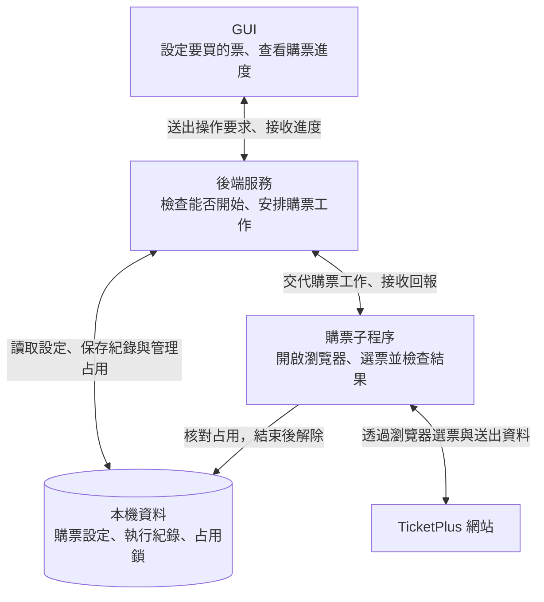

# 系統架構與資料流

本文件用架構圖介紹系統組成，再用時序圖說明各部分之間的資料流。

## 整體架構

箭頭表示互動關係，不代表執行順序。除了 TicketPlus 網站，其餘部分都在你的電腦上。

「占用鎖」用來防止同時啟動多個購票流程。子程序必須等流程與瀏覽器都結束，才解除占用。

## 從哪裡開始讀

| 文件 | 回答的問題 |
| --- | --- |
| [1. 開始購票與回報進度](start-and-progress.md) | 按下開始後，設定和進度怎麼傳？ |
| [2. 關閉瀏覽器與解除占用](close-and-release.md) | 有結果之後，怎麼正常結束？ |
| [3. 子程序異常結束](interrupted-run.md) | 子程序突然結束時，後端怎麼處理？ |
| [4. 停止與抽選人工確認](run-controls.md) | 按下停止或參加者已填完後，會發生什麼事？ |

## 時序圖的溝通方式

| 標示 | 意思 |
| --- | --- |
| HTTP API | GUI 提出要求，後端回覆處理結果 |
| SSE | 後端透過 HTTP 長連線，持續把完整的最新狀態送給 GUI |
| IPC | 後端與購票子程序互傳訊息 |
| 檔案讀寫 | 從硬碟讀取資料，或將資料保存到硬碟 |

## 使用的技術

| 技術 | 用在哪裡 | 用途 |
| --- | --- | --- |
| React | GUI | 建立設定與進度畫面 |
| Node.js | 後端服務、購票子程序 | 執行服務與購票程式 |
| Playwright | 購票子程序 | 操作瀏覽器、讀取網站狀態 |
| Node.js `fork` | 後端服務 | 建立購票子程序及 IPC 通道 |

[開始閱讀第一節 →](start-and-progress.md)
