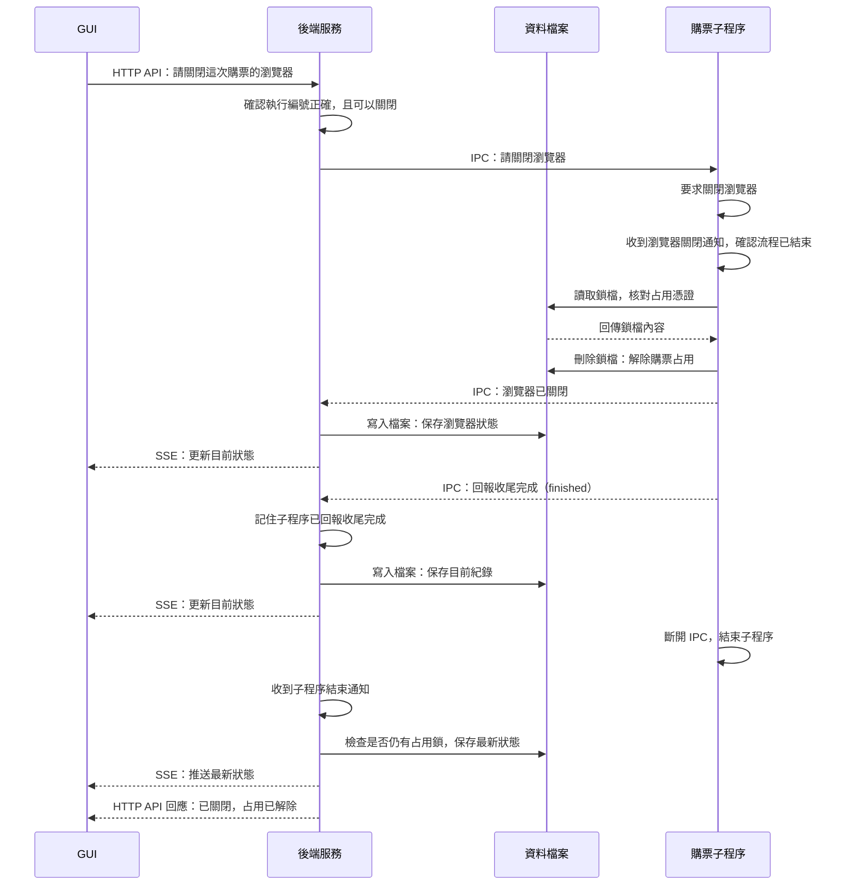

# 2. 關閉瀏覽器與解除占用

圖中呈現自動操作已有結果後，從 GUI 關閉瀏覽器且成功解除占用的流程。

## 重要設計

- **由子程序核對並解鎖：** 流程與瀏覽器都結束後，子程序才核對占用憑證並刪除鎖檔。直接關閉購票瀏覽器，也必須滿足相同條件。
- **收尾通知不等於已結束：** 後端會等子程序結束，再確認瀏覽器與占用都已解除，才回覆關閉成功。收到購票結果不代表已付款或完成最終登記。
- **失敗時不強制解鎖：** 關閉失敗、逾時或解鎖失敗時，會回報問題，保留現況供人工檢查。

## 對應程式

- [關閉與結束管理](../../src/server/runs/purchaseRuns.ts)：`closeBrowser`、`attachWorker`。
- [子程序控制](../../src/workers/purchaseWorker.ts)：關窗訊息、`result` 與 `finished`。
- [TicketPlus 流程](../../src/app/flows/ticketplus/runTicketPlus.ts)：`release` 與瀏覽器關閉事件。
- [占用鎖](../../src/storage/purchaseLock.ts)：`verifyPurchaseLease`、`releasePurchaseLease`。

[← 上一節：開始購票與回報進度](start-and-progress.md) · [導覽](README.md) · [下一節：子程序異常結束 →](interrupted-run.md)
