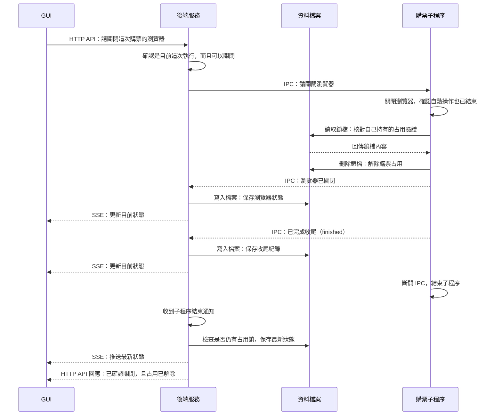

# 2. 關閉瀏覽器與解除占用

這張圖回答：自動操作有結果之後，誰負責關閉瀏覽器、解除占用？

情境：已有執行結果，使用者透過 GUI 關閉仍開啟的購票瀏覽器，關閉與解鎖都成功。

## 閱讀重點

- GUI 呼叫 `POST /api/purchase/close-browser`。後端核對執行 ID 和關閉資格；仍在執行自動操作時，不能使用這個操作關窗。
- 解鎖的是子程序內的流程程式，不是後端。它必須確認流程已結束、瀏覽器已關閉，再核對 token 並刪除鎖檔。
- `result` 表示自動操作有結果；`finished` 表示 worker 已走到收尾通知。後端還要檢查子程序是否正常結束，以及鎖檔是否仍存在，不能只憑一個訊息判定已解除占用。
- 使用者也能直接關閉購票瀏覽器。此時沒有前面的 GUI 關閉請求，但仍由子程序在流程與瀏覽器都結束後處理解鎖。
- 圖中省略 IPC 斷線時的額外 SSE 通知。正常路徑的最後 HTTP 回應會等待子程序結束並確認沒有占用；關閉失敗、逾時或解鎖失敗時，會回報問題，不會強制刪鎖。
- 即使鎖檔已刪除，只要後端仍持有這個子程序，仍會視為占用，避免過早開始下一輪。

## 對應程式

- [關閉與結束管理](../../src/server/runs/purchaseRuns.ts)：`closeBrowser`、`attachWorker`。
- [子程序控制](../../src/workers/purchaseWorker.ts)：關窗訊息、`result` 與 `finished`。
- [TicketPlus 流程](../../src/app/flows/ticketplus/runTicketPlus.ts)：`release` 與瀏覽器關閉事件。
- [占用鎖](../../src/storage/purchaseLock.ts)：`verifyPurchaseLease`、`releasePurchaseLease`。

[← 上一節：開始購票與回報進度](start-and-progress.md) · [導覽](README.md) · [下一節：子程序異常結束 →](interrupted-run.md)
