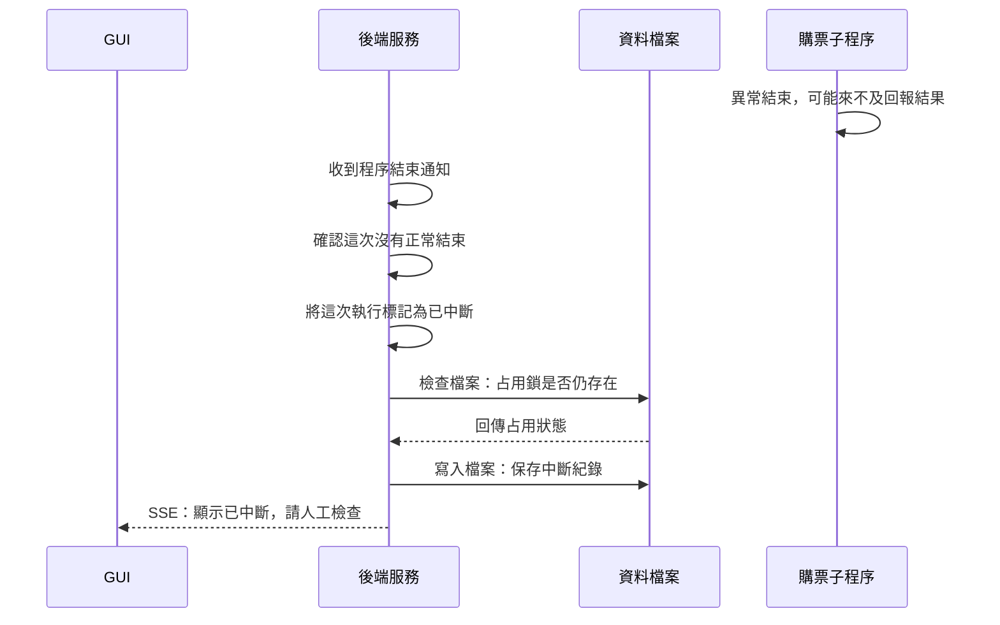

# 3. 子程序異常結束

圖中呈現後端仍在執行、子程序未正常結束，而且中斷紀錄能成功保存的流程。

## 重要設計

- **不自動重跑：** 沒收到結果，不代表網站沒有接受操作。中斷後應檢查原頁面與訂單，不能直接重送。
- **不強制解鎖：** 後端只檢查鎖檔是否存在；鎖還在就保留，已解除的占用也不會重新建立。
- **以實際結束狀態判斷：** 即使先前收到結果，子程序仍可能異常結束。若連紀錄也寫入失敗，後端會通知 GUI，但不能保證中斷狀態已存入檔案。

## 對應程式

- [執行管理](../../src/server/runs/purchaseRuns.ts)：建構子讀取歷史紀錄，`attachWorker` 處理異常結束。
- [購票子程序](../../src/workers/purchaseWorker.ts)：父服務失聯處理。
- [執行紀錄儲存](../../src/server/runs/runRecordStore.ts)：紀錄讀寫。

[← 上一節：關閉瀏覽器與解除占用](close-and-release.md) · [導覽](README.md) · [下一節：停止與抽選人工確認 →](run-controls.md)
