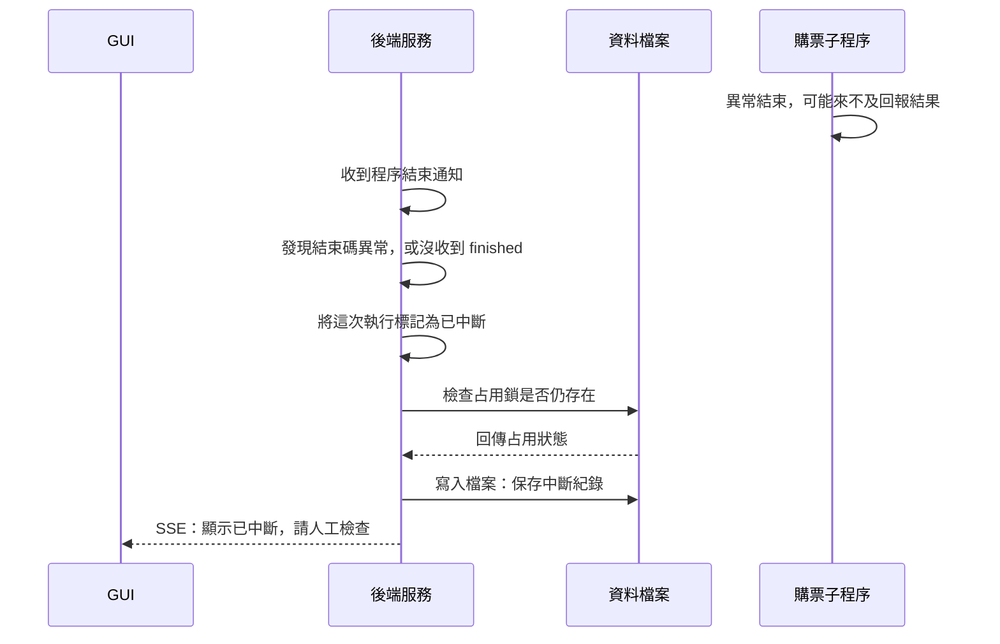

# 3. 子程序異常結束

這張圖回答：子程序突然結束，沒能正常交接時，後端怎麼處理？

情境：後端仍在執行，收到子程序結束通知，發現結束碼不是 0，或沒有收到 `finished`。圖中假設執行紀錄能成功保存。

## 閱讀重點

- 程序結束通知是 Node.js 子程序的 `close` 事件，不是購票子程序透過 IPC 回報。異常時可能根本來不及送出訊息。
- 後端不自動重新購票，也不會因異常而強制刪除鎖檔。鎖仍存在就保留；若子程序先前已正常解除占用，後端也不會重新建立鎖。
- 即使先前收到結果，只要結束碼異常或缺少 `finished`，後端仍會將狀態改為 `interrupted`，提示檢查原頁面與訂單。
- 如果連執行紀錄也寫入失敗，後端會把目前記憶體狀態改為已中斷，提示寫入失敗並通知 GUI；不能說磁碟一定已保存這個結果。
- 後端重新啟動是另一種情境：它會讀取既有紀錄，將選為目前紀錄且仍為 `running` 的那筆改為 `interrupted`，不自動續跑，也不自動清鎖。
- 若子程序與父服務失聯，子程序會退出；這也不授權後端或 GUI 自動重送購票。

## 對應程式

- [執行管理](../../src/server/runs/purchaseRuns.ts)：建構子讀取歷史紀錄，`attachWorker` 處理異常結束。
- [購票子程序](../../src/workers/purchaseWorker.ts)：父服務失聯處理。
- [執行紀錄儲存](../../src/server/runs/runRecordStore.ts)：紀錄讀寫。

[← 上一節：關閉瀏覽器與解除占用](close-and-release.md) · [導覽](README.md) · [下一節：停止與抽選人工確認 →](run-controls.md)
