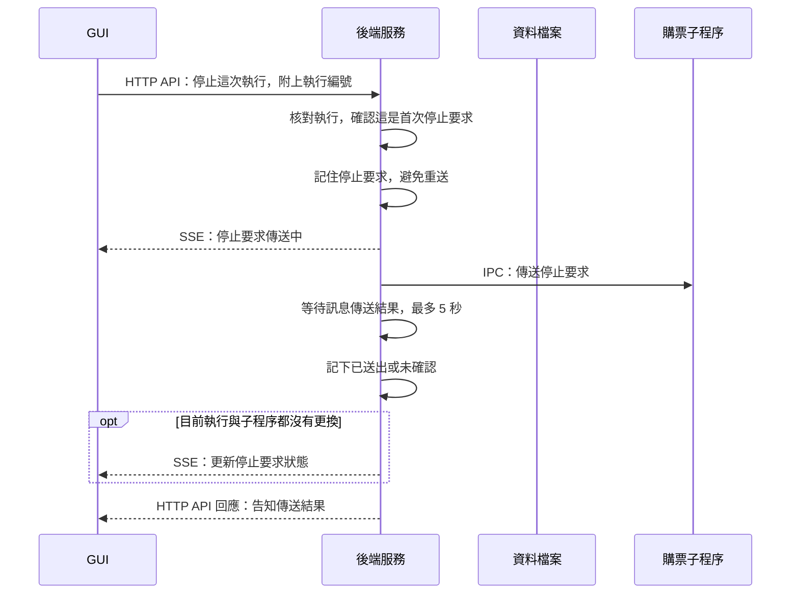
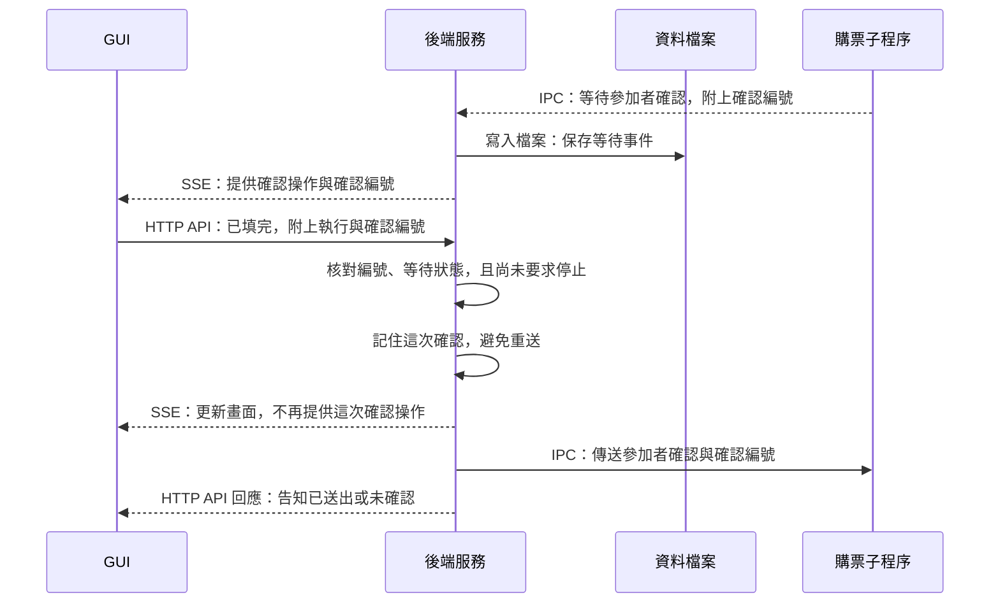

# 4. 停止與抽選人工確認

## 按下停止後

停止要求記在記憶體中，因此這段沒有寫檔箭頭；後續進度與結果仍會依一般回報流程保存。

## 按下參加者已填完後

兩張圖是獨立操作，呈現首次要求通過檢查後的傳送流程；後續進度與結果見 [第一節](start-and-progress.md)。

## 重要設計

- **傳送成功不等於操作完成：** HTTP 回應只說明傳送結果。停止圖的 5 秒是等待傳送結果的上限，不是保證流程會在 5 秒內停止；停止也不會撤回網站請求或自動關窗。
- **同一操作不反覆傳送：** GUI 與後端都會防止重送，傳送結果不明也不自動重試。同一輪停止要求再次送來時，後端回傳既有狀態，不再轉送。
- **參加者確認仍須核對：** 確認編號只對應當前等待，不能重複使用；已要求停止時不能再確認。GUI 只送編號，不送參加者身分資料，子程序核對人數與填寫狀態後才繼續，並停在最終登記確認前。

## 對應程式

- [GUI 操作](../../src/gui/shared/runs/useRunStatus.ts)：停止與參加者確認 API。
- [後端操作管理](../../src/server/runs/purchaseRuns.ts)：`stop`、`pendingParticipants`、`confirmParticipants`。
- [停止訊息傳送](../../src/server/runs/sendWorkerStop.ts)：傳送回呼、逾時及失聯處理。
- [子程序控制](../../src/workers/purchaseWorker.ts)：停止訊號與確認訊息接收。
- [一次性參加者確認](../../src/workers/participantConfirmation.ts)：目前等待的確認編號核對。
- [抽選收尾](../../src/app/flows/ticketplus/finishLottery.ts)：等待確認及核對後繼續流程。
- [DOM 快照](../../src/platforms/ticketplus/domSnapshot.ts) 與 [參加者狀態解析](../../src/platforms/ticketplus/lotteryInput.ts)：將參加者列轉成填寫狀態，供後續核對。

[← 上一節：子程序異常結束](interrupted-run.md) · [回到導覽](README.md)
