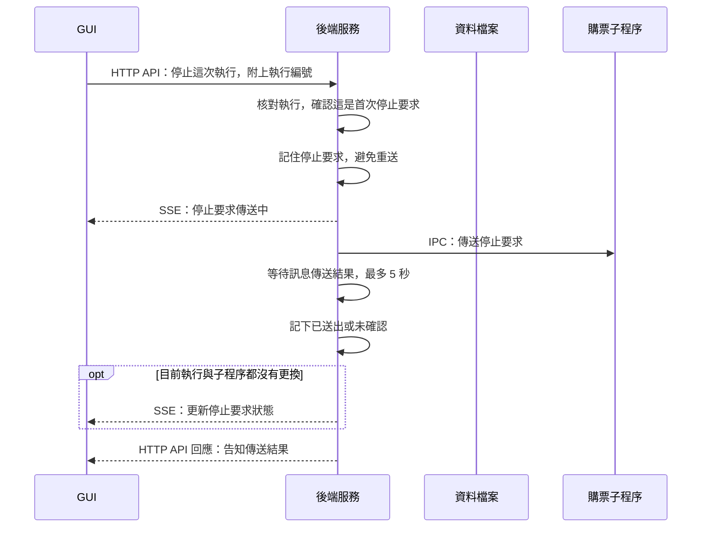
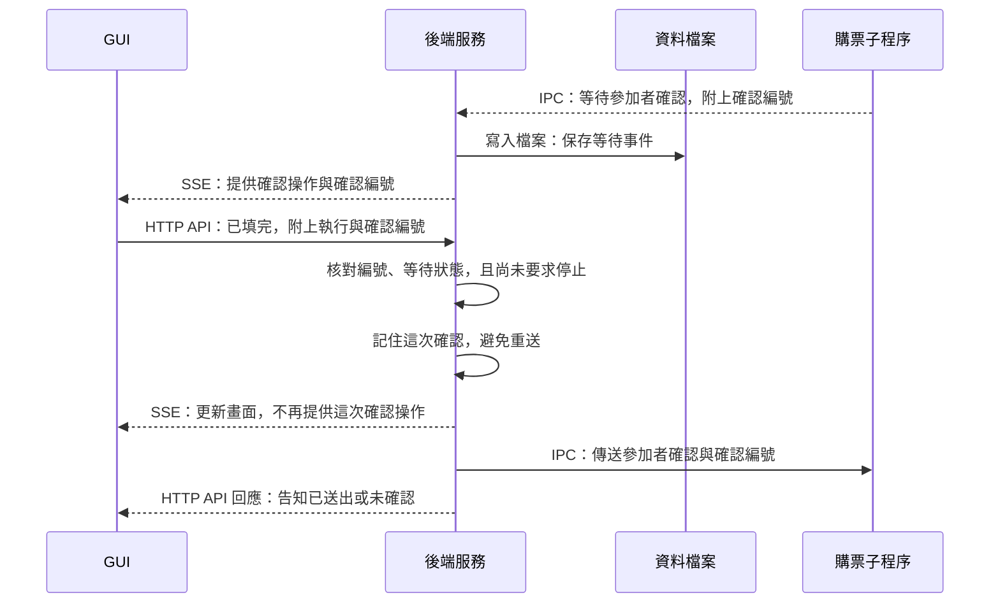

# 4. 停止與抽選人工確認

GUI 把操作要求交給後端檢查，再由後端轉送給購票子程序。

下面兩張圖分別說明停止與參加者確認，兩者是獨立操作。圖中都是目前子程序仍連線、第一次提出的操作通過檢查；後續傳送可能成功或未確認。後續進度與結果走 [第一節](start-and-progress.md) 的回報流程。

## 按下停止後

這段控制流程不寫資料檔案，所以圖中的「資料檔案」沒有箭頭。收到後續進度或執行結果時，後端才依一般回報流程保存。

## 按下參加者已填完後

## 先記住這三件事

1. **已送出不代表已完成。** 停止或確認的 HTTP 回應只說明傳送結果，後續仍要看執行狀態。
2. **同一操作不反覆傳送。** GUI 和後端都有防重送措施，傳送結果不明也不會自動重送。
3. **確認已填完後仍要核對。** 子程序還會檢查參加者人數與填寫狀態，不會直接完成最終登記。

## 技術補充

### 共同的傳送規則

- 停止使用 `POST /api/purchase/stop`；參加者確認使用 `POST /api/purchase/confirm-participants`。
- HTTP 回應與停止要求的「已送出」只表示傳送結果，不代表子程序已完成操作。worker 的進度或結果可能先於 HTTP 回應到達，兩者沒有固定送達順序。
- GUI 在送出 API 前，也會用 `attemptedStops` 和 `attemptedParticipants` 記住本頁已嘗試的操作；回應失敗或不明時不解除這個防重送限制。後端仍須獨立核對，不能只信任 GUI。

### 停止要求

- 子程序收到停止訊息後，透過 `AbortController` 通知流程停止。停止不代表撤回網站已送出的請求，也不會自動關閉供人工檢查的瀏覽器；應繼續查看執行結果。
- 停止傳送成功的 IPC 回呼會得到「已送出」；等待傳送結果期間若傳送失敗、斷線、子程序退出、發生錯誤事件或 5 秒逾時，則得到「未確認」。這是等待傳送結果的期限，不是保證流程會在 5 秒內停止。
- 同一輪停止要求再次送來，後端回傳既有要求狀態，不再次轉送。傳送失敗或未確認也不自動重送。

### 參加者確認

- 抽選等待時，參加者資料由使用者在網站填寫；GUI 傳送的是執行與確認編號，不是參加者身分資料。參加者核對流程接收的是每列是否填完的布林值，不是姓名或證件號碼。DOM 讀取會在瀏覽器內檢查參加者列的文字是否為空，再回傳布林值；原始文字不作為參加者核對資料傳回。
- 子程序只接受當前等待中、格式與確認編號皆正確的參加者確認一次。接受後仍須核對人數及填寫完成狀態，才勾選條款並按一次下一步，停在最終確認登記之前。
- 後端在傳送確認前先記住已送出，失敗也不重送。執行編號不符、已不在執行中、子程序不存在或失聯、沒有等待中的確認、已要求停止、確認編號不符或已確認過時，都會拒絕新的確認要求。

### 哪些資料會保存

- 停止要求及「確認已送出」標記保存在目前服務的記憶體，並非每個控制動作都寫檔。等待事件、後續進度與結果則依一般回報流程保存。

## 對應程式

- [GUI 操作](../../src/gui/shared/runs/useRunStatus.ts)：停止與參加者確認 API。
- [後端操作管理](../../src/server/runs/purchaseRuns.ts)：`stop`、`pendingParticipants`、`confirmParticipants`。
- [停止訊息傳送](../../src/server/runs/sendWorkerStop.ts)：傳送回呼、逾時及失聯處理。
- [子程序控制](../../src/workers/purchaseWorker.ts)：停止訊號與確認訊息接收。
- [一次性參加者確認](../../src/workers/participantConfirmation.ts)：目前等待的確認編號核對。
- [抽選收尾](../../src/app/flows/ticketplus/finishLottery.ts)：等待確認及核對後繼續流程。
- [DOM 快照](../../src/platforms/ticketplus/domSnapshot.ts) 與 [參加者狀態解析](../../src/platforms/ticketplus/lotteryInput.ts)：將參加者列轉成填寫狀態，供後續核對。

[← 上一節：子程序異常結束](interrupted-run.md) · [回到導覽](README.md)
