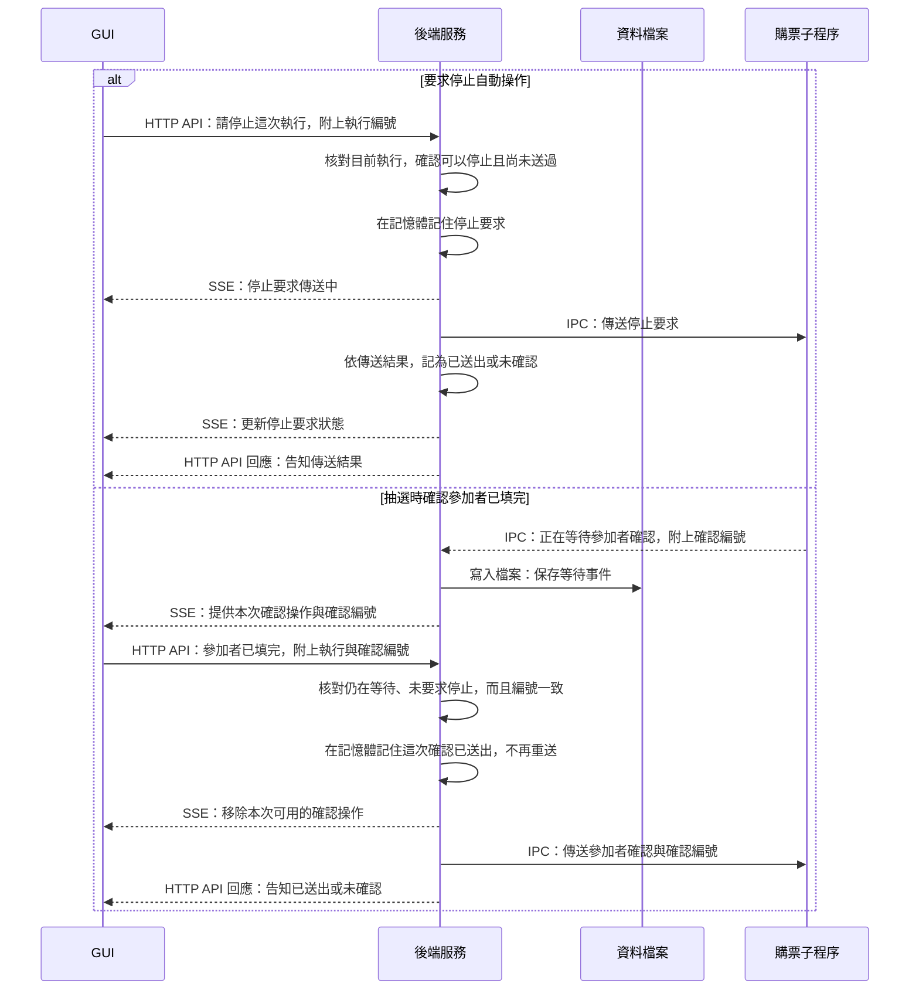

# 4. 停止與抽選人工確認

這張圖回答：GUI 如何把操作要求送到正在執行的購票子程序？

情境：目前子程序仍連線，而且操作通過後端檢查。兩個分支代表不同操作，不是先停止再確認參加者。圖集中呈現控制訊息的傳遞；後續進度與結果走第一節的回報流程。

## 閱讀重點

- 停止使用 `POST /api/purchase/stop`；參加者確認使用 `POST /api/purchase/confirm-participants`。
- HTTP 回應與停止要求的「已送出」只表示傳送結果，不代表子程序已完成操作。worker 的進度或結果可能先於 HTTP 回應到達，兩者沒有固定送達順序。
- 子程序收到停止訊息後，透過 `AbortController` 通知流程停止。停止不代表撤回網站已送出的請求，也不會自動關閉供人工檢查的瀏覽器；應繼續查看執行結果。
- 同一輪停止要求再次送來，後端回傳既有要求狀態，不再次轉送。傳送失敗或未確認也不自動重送。
- 抽選等待時，參加者資料由使用者在網站填寫；GUI 傳送的是執行與確認編號，不是參加者身分資料。購票程式不讀取或保存參加者證件資料。
- 子程序只接受當前等待中、格式與確認編號皆正確的參加者確認一次。接受後仍須核對人數及填寫完成狀態，才勾選條款並按一次下一步，停在最終確認登記之前。
- 後端在傳送確認前先記住已送出，失敗也不重送。已要求停止、確認編號不符或已確認過時，會拒絕新的確認要求。
- 停止要求及「確認已送出」標記保存在目前服務的記憶體，並非每個控制動作都寫檔。等待事件、後續進度與結果則依一般回報流程保存。

## 對應程式

- [GUI 操作](../../src/gui/shared/runs/useRunStatus.ts)：停止與參加者確認 API。
- [後端操作管理](../../src/server/runs/purchaseRuns.ts)：`stop`、`pendingParticipants`、`confirmParticipants`。
- [停止訊息傳送](../../src/server/runs/sendWorkerStop.ts)：傳送回呼、逾時及失聯處理。
- [子程序控制](../../src/workers/purchaseWorker.ts)：停止訊號與確認訊息接收。
- [一次性參加者確認](../../src/workers/participantConfirmation.ts)：目前等待的確認編號核對。
- [抽選收尾](../../src/app/flows/ticketplus/finishLottery.ts)：等待確認及核對後繼續流程。

[← 上一節：子程序異常結束](interrupted-run.md) · [回到導覽](README.md)
