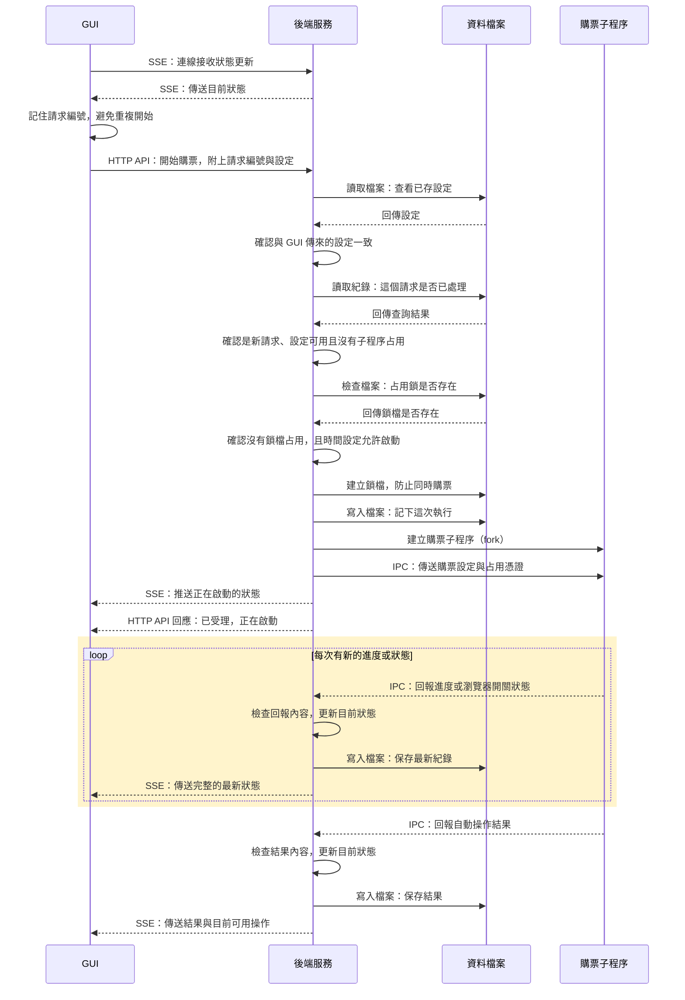

# 1. 開始購票與回報進度

圖中呈現新的開始請求通過檢查後的流程；重複請求不會再次啟動購票。

## 重要設計

- **避免重複購票：** 後端先建立占用鎖、保存紀錄，才啟動子程序。同一請求再次送來且核對一致時，回傳原結果，不重新購票。
- **進度回報不阻塞購票：** 子程序不必等待 GUI 更新，才繼續操作。HTTP 回應與 SSE 更新也可能交錯到達；「已受理」不代表購票瀏覽器已準備好。
- **結果與收尾分開：** 回報結果後，瀏覽器可能仍開著，占用尚未解除。後續處理見 [第二節](close-and-release.md)。

## 對應程式

- [GUI 開始請求](../../src/gui/platforms/ticketplus/startPurchase.ts)：保存設定、待確認請求及開始 API。
- [GUI 狀態訂閱](../../src/gui/shared/runs/useRunStatus.ts)：SSE 與初始查詢。
- [購票 API](../../src/server/routes/purchaseRoutes.ts)：設定比對與 SSE。
- [執行管理](../../src/server/runs/purchaseRuns.ts)：`start`、`previousResult`、`attachWorker`。
- [購票子程序](../../src/workers/purchaseWorker.ts)：IPC 與結果回報。

[← 導覽](README.md) · [下一節：關閉瀏覽器與解除占用 →](close-and-release.md)
