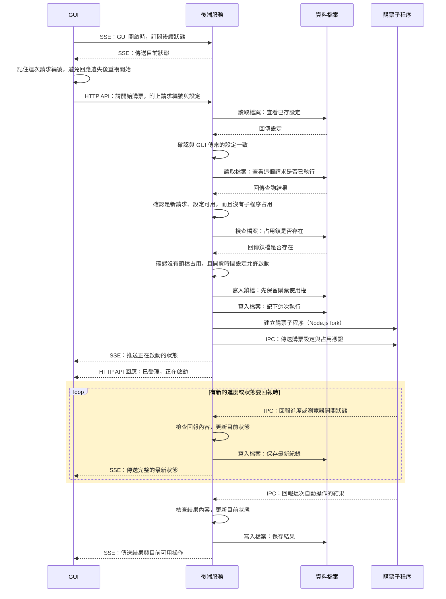

# 1. 開始購票與回報進度

這張圖回答：按下開始後，設定交給誰，進度又怎麼回到 GUI？

情境：活動設定已儲存，新的開始請求通過檢查，子程序能正常回報。圖從 GUI 訂閱狀態開始，畫到自動操作回報結果。

## 閱讀重點

- GUI 載入時也會發出 `GET /api/purchase` 讀取目前狀態，與 SSE 訂閱並行。開始購票不必等待 SSE 連線成功；GUI 需要先取得可用狀態。
- 開始請求是 `POST /api/purchase`，包含 `requestId`、`activityId` 和 `expectedActivity`。若設定有修改，GUI 先保存，再以 `sessionStorage` 記住待確認的請求。
- 啟動檢查包含設定、重複請求、占用及開賣時間。同一請求再次送來且核對一致時，直接回傳既有結果，不重新啟動；換設定、換活動或無法確認相容性時拒絕。
- 設定核對分兩層：路由先比對 GUI 設定與目前存檔；通過後，執行管理才查相同請求的歷史紀錄。若第一層不一致，會先拒絕，不會進入重複請求處理。
- 圖中的新請求沒有其他子程序占用，所以會檢查鎖檔是否存在；實際 `busy()` 若已持有子程序，就直接判定占用，不必再查檔。
- 後端先建立 `purchase.lock`，再保存執行紀錄，最後啟動子程序。啟動途中出錯不會自行猜測可以重跑。
- 「已受理」不代表購票瀏覽器已準備好。啟動時後端先通知 SSE，再寫 HTTP 回應，但 GUI 收到的順序不保證。
- 黃色區塊是事件回報，不是每個網站操作都要走一次。子程序不等待後端存檔或 GUI 更新後才繼續操作。圖只呈現後端接受的回報。無法辨識的訊息會略過；某些格式錯誤會使後端結束子程序，詳見第三節。`close-error` 不走這條寫檔與推送路徑，但關窗請求的專用處理仍會接收它並回報失敗。
- 子程序回報 `outcome`、`message` 和選填的 `stopReason`；後端另外計算 GUI 現在可以做哪些操作。結果回報後仍可能保留購票瀏覽器，等待人工接手。
- 本圖停在結果交接，並非所有訊息都已結束。正常關窗時，子程序還會回報瀏覽器已關閉及 `finished`，後端都會寫檔並推送 SSE；接續流程見 [第二節](close-and-release.md)。

## 對應程式

- [GUI 開始請求](../../src/gui/platforms/ticketplus/startPurchase.ts)：保存設定、待確認請求及開始 API。
- [GUI 狀態訂閱](../../src/gui/shared/runs/useRunStatus.ts)：SSE 與初始查詢。
- [購票 API](../../src/server/routes/purchaseRoutes.ts)：設定比對與 SSE。
- [執行管理](../../src/server/runs/purchaseRuns.ts)：`start`、`previousResult`、`attachWorker`。
- [購票子程序](../../src/workers/purchaseWorker.ts)：IPC 與結果回報。

[← 導覽](README.md) · [下一節：關閉瀏覽器與解除占用 →](close-and-release.md)
